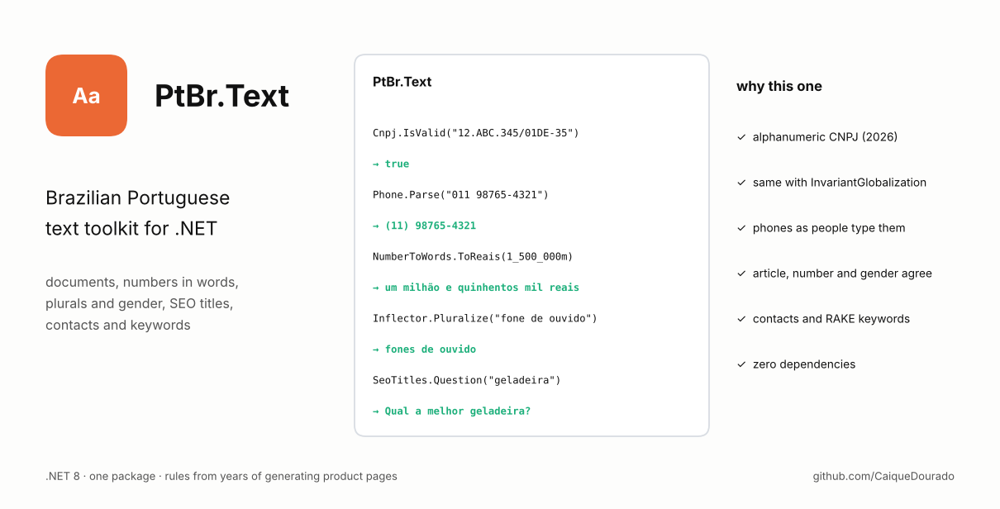

# PtBr.Text

[](https://github.com/CaiqueDourado/PtBr.Text/actions/workflows/ci.yml)
[](LICENSE)




**Brazilian Portuguese text toolkit for .NET.** Documents (CPF, CNPJ — including the new alphanumeric format — CEP, phones), numbers in words and in reais, slugs, plural and gender, SEO titles, price history narratives, contact extraction and keyword extraction. One package, zero dependencies.

[Leia em português](README.pt-BR.md)

```csharp
Cnpj.IsValid("12.ABC.345/01DE-35");                 // true  — 2026 alphanumeric CNPJ
Phone.Parse("011 98765-4321")?.Formatted;             // "(11) 98765-4321"
NumberToWords.ToReais(1_500_000m);                    // "um milhão e quinhentos mil reais"
Inflector.Pluralize("fone de ouvido");                // "fones de ouvido"
SeoTitles.Question("geladeira");                      // "Qual a melhor geladeira?"
TextNormalizer.Slugify("Fogão 4 Bocas & Forno");      // "fogao-4-bocas-e-forno"
DurationParser.ToIso8601("uma hora e meia");          // "PT1H30M"
```

## Why another one

- **Alphanumeric CNPJ.** From July 2026 the Receita Federal issues CNPJs with letters (`12.ABC.345/01DE-35`). Most validators reject them.
- **Works with `InvariantGlobalization`.** Many libraries remove accents with `string.Normalize(FormD)`, which silently does nothing in containers and trimmed apps running in invariant mode. Here every function behaves the same with and without ICU — CI tests both.
- **Real-world Portuguese.** Phones typed as `0 21 11 3456-7890`, prices in `R$`, "1h30" in recipes, product names in ALL CAPS, plurals like *papéis*, *níveis*, *pães*, *tênis*.
- **Text generation that respects grammar.** Article, number and gender agree: "Qual **a** melhor geladeira?", "Quais **os** melhores fones de ouvido?".

The rules come from years of generating product and category pages for Brazilian e-commerce sites; the code is a clean, tested rewrite.

## Install

```bash
git clone https://github.com/CaiqueDourado/PtBr.Text.git
dotnet add reference PtBr.Text/src/PtBr.Text/PtBr.Text.csproj
```

Releases attach the `.nupkg` to the [GitHub Releases](https://github.com/CaiqueDourado/PtBr.Text/releases) page.

## What is inside

### Documents — `PtBr.Text.Documents`

| API | Notes |
| --- | --- |
| `Cpf.IsValid / Format / CheckDigits / Generate` | Rejects runs of one digit (`111.111.111-11`) that pass the arithmetic. |
| `Cnpj.IsValid / Format / IsAlphanumeric / Root / IsHeadOffice / Generate` | Numeric and alphanumeric (IN RFB 2.229/2024). |
| `Cep.Format / GetState / IsValid` | State (UF) from the Correios numeric ranges. |
| `Phone.Parse / Format / IsValid` | Mobile, landline, 0800/0300/0500/0900, 3003/400x; `+55`, trunk `0` and carrier codes; validates the 67 DDDs; `E164`, `TelUri`. |

`Generate` methods exist for tests and sample data only.

### Text and numbers — `PtBr.Text`, `PtBr.Text.Numbers`

| API | Example |
| --- | --- |
| `TextNormalizer.RemoveAccents` | `"Ação"` → `"Acao"` (ICU-free) |
| `TextNormalizer.Slugify` | `"Caixa d'água 1000 litros"` → `"caixa-dagua-1000-litros"`, with max length cut at a word boundary |
| `TextNormalizer.ToTitleCase` | `"GELADEIRA FROST FREE DE 375L"` → `"Geladeira Frost Free de 375L"` |
| `NumberToWords.ToWords` | `1250` → `"mil duzentos e cinquenta"`; `2200, Gender.Feminine` → `"duas mil e duzentas"` |
| `NumberToWords.ToReais` | `1.5m` → `"um real e cinquenta centavos"`; `1_000_000m` → `"um milhão de reais"` |
| `DurationParser.ToIso8601` | `"1h30"`, `"90 minutos"`, `"uma hora e meia"` → `"PT1H30M"` (schema.org `Recipe.totalTime`) |
| `BrazilianFormat.Money / Number / Date` | `1299.9m` → `"R$ 1.299,90"` regardless of server culture |

### Language — `PtBr.Text.Inflection`

| API | Example |
| --- | --- |
| `Inflector.Pluralize` | `fogão` → `fogões`, `pão` → `pães`, `papel` → `papéis`, `nível` → `níveis`, `tênis` → `tênis` |
| `Inflector.IsPlural` | `geladeiras` → true, `tênis`, `mês` → false |
| `Inflector.GuessGender` | `geladeira`, `televisão`, `smart tv` → feminine; `fogão`, `problema`, `sofá` → masculine |
| `SeoTitles.Question` | `"Quais as melhores panelas?"`, `"Qual a pior air fryer?"` |
| `SeoTitles.Headline` | `"As 10 melhores geladeiras para comprar em 2026"` |

Only the first word of a multi-word term is inflected ("fone de ouvido" → "fones de ouvido"), which suits the *noun + complement* shape of most product names. Irregular words can be added with `Inflector.AddException`.

### Price history narrative — `PtBr.Text.Narratives`

```csharp
var narrative = PriceHistoryNarrator.Describe("Geladeira Exemplo 375L", history, today);
narrative.Text;
// Monitoramos o preço de Geladeira Exemplo 375L há 4 meses. O preço médio é R$ 3.724,45.
// O preço varia de R$ 3.499,00 a R$ 3.999,90, dependendo da loja. O menor preço registrado foi
// R$ 3.499,00, em 01/08/2026, na loja Loja B. ... A oferta mais barata no momento é R$ 3.599,00, na loja Loja B.
narrative.Faq;   // "Qual o preço de ...?", "Qual o menor preço de ...?", "Onde comprar ... mais barato?"
```

Facts only: every sentence is computed from the data, ready for a page and for a schema.org `FAQPage`.

### Contacts — `PtBr.Text.Contacts`

```csharp
var contacts = ContactExtractor.Extract("SAC: (11) 98765-4321 / 0800 123 4567 - atendimento@loja.com.br - www.loja.com.br");
var html = ContactExtractor.Linkify(text);   // tel:, mailto: and https links; everything else HTML-encoded
```

Built for messy "Fale conosco" text: does not mistake CNPJs, CEPs or "Ltda.ME" for contacts.

### Keywords — `PtBr.Text.Keywords`

```csharp
RakeExtractor.Extract("A bateria dura muito e a câmera noturna surpreende.");
// "câmera noturna surpreende", "bateria dura"

// For short texts such as reviews, split only on conjunctions to keep longer phrases:
RakeExtractor.Extract(review, options: new RakeOptions { Stopwords = Stopwords.Conjunctions, MaxWords = 8 });
```

RAKE (Rose et al., 2010) implemented from the paper, keeping accented letters inside words, with a Portuguese stopword list written for this project.

## Roadmap

- Syllabification and stressed syllable (written from the phonological rules, with a test corpus).
- Clause splitting for reviews with a pluggable part-of-speech tagger.
- More data-to-text narratives (product specs, rankings).

## Related

- Article: [Enriching sign-up data with open APIs](https://medium.com/@caiquedourado/enriching-sign-up-data-with-open-apis-37388f435398) (Medium): CEP, DDD and phones next to the IBGE APIs.
- [google-keywords-dataset](https://github.com/CaiqueDourado/google-keywords-dataset): 38 million Google searches with volume and CPC, 4 million of them Brazilian questions; good input for the RAKE extractor and the stopwords here ([Kaggle](https://www.kaggle.com/datasets/caiquedourado/google-keywords-dataset)).
- [fipe-ficha-tecnica-veiculos](https://github.com/CaiqueDourado/fipe-ficha-tecnica-veiculos): its `textos/` module writes vehicle pages from FIPE prices and specifications (about paragraph, equipment, price history, FAQ). Same idea as the narratives here, in Python: every sentence comes from a field, with gender, number and money written right.
- [dicionario-portugues](https://github.com/CaiqueDourado/dicionario-portugues): 272 thousand Portuguese words with phonetic keys, rhymes and AI-generated texts ([Kaggle](https://www.kaggle.com/datasets/caiquedourado/dicionario-portugues)): singular, plural, feminine and part of speech for 188 thousand words, generated by AI and not reviewed; a test bed for the inflection rules here.

## Contributing

Wrong plural, gender or number in words? Open an issue with the input, the result and the expected value — or add it to the tests. See [CONTRIBUTING.md](CONTRIBUTING.md).

## License

[MIT](LICENSE) © Caique Dourado
