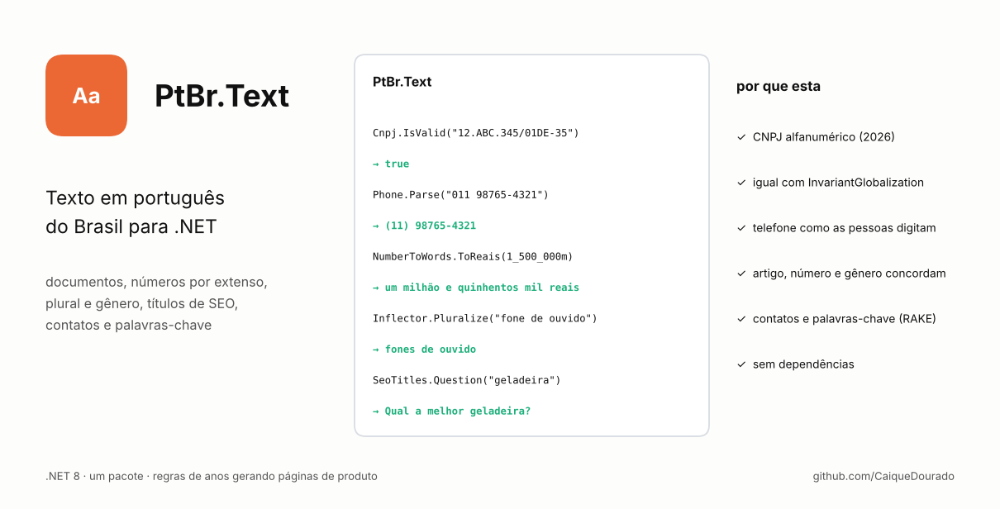

# PtBr.Text

[](https://github.com/CaiqueDourado/PtBr.Text/actions/workflows/ci.yml)
[](LICENSE)




**Kit de texto em português do Brasil para .NET.** Documentos (CPF, CNPJ — inclusive o novo alfanumérico —, CEP, telefone), número por extenso e em reais, slug, plural e gênero, títulos para SEO, narrativa de histórico de preço, extração de contatos e de palavras-chave. Um pacote, zero dependências.

[Read in English](README.md)

```csharp
Cnpj.IsValid("12.ABC.345/01DE-35");                 // true  — CNPJ alfanumérico de 2026
Phone.Parse("011 98765-4321")?.Formatted;             // "(11) 98765-4321"
NumberToWords.ToReais(1_500_000m);                    // "um milhão e quinhentos mil reais"
Inflector.Pluralize("fone de ouvido");                // "fones de ouvido"
SeoTitles.Question("geladeira");                      // "Qual a melhor geladeira?"
TextNormalizer.Slugify("Fogão 4 Bocas & Forno");      // "fogao-4-bocas-e-forno"
DurationParser.ToIso8601("uma hora e meia");          // "PT1H30M"
```

## Por que mais uma

- **CNPJ alfanumérico.** A partir de julho de 2026 a Receita Federal emite CNPJs com letras (`12.ABC.345/01DE-35`). A maioria dos validadores rejeita.
- **Funciona com `InvariantGlobalization`.** Muitas bibliotecas tiram acento com `string.Normalize(FormD)`, que não faz nada em containers e apps "trimmed" rodando em modo invariante. Aqui tudo se comporta igual com e sem ICU — o CI testa os dois.
- **Português de verdade.** Telefone digitado como `0 21 11 3456-7890`, preço em `R$`, "1h30" em receita, nome de produto em CAIXA ALTA, plurais como *papéis*, *níveis*, *pães*, *tênis*.
- **Geração de texto que respeita a gramática.** Artigo, número e gênero concordam: "Qual **a** melhor geladeira?", "Quais **os** melhores fones de ouvido?".

As regras vêm de anos gerando páginas de produto e categoria para sites de e-commerce brasileiros; o código é uma reescrita limpa e testada.

## O que tem

| Área | Principais APIs |
| --- | --- |
| Documentos | `Cpf`, `Cnpj` (numérico e alfanumérico), `Cep` (com UF pela faixa dos Correios), `Phone` (celular, fixo, 0800, 400x, +55, operadora, 67 DDDs) |
| Texto | `TextNormalizer.RemoveAccents`, `Slugify`, `ToTitleCase`, `CollapseWhitespace` |
| Números | `NumberToWords.ToWords` (com gênero), `ToReais`, `DurationParser.ToIso8601`, `BrazilianFormat.Money` |
| Linguagem | `Inflector.Pluralize`, `IsPlural`, `GuessGender`, `SeoTitles.Question`, `SeoTitles.Headline` |
| Narrativas | `PriceHistoryNarrator.Describe` → frases e perguntas/respostas para FAQ |
| Contatos | `ContactExtractor.Extract` e `Linkify` |
| Palavras-chave | `RakeExtractor.Extract`, `Stopwords.Portuguese`, `Stopwords.Conjunctions` |

Exemplos detalhados de cada uma estão no [README em inglês](README.md#what-is-inside).

## Próximos passos

- Separação silábica e sílaba tônica, escritas a partir das regras fonológicas e com corpus de teste.
- Divisão de orações para reviews, com etiquetador gramatical plugável.
- Mais narrativas a partir de dados (ficha técnica, rankings).

## Relacionados

- [google-keywords-dataset](https://github.com/CaiqueDourado/google-keywords-dataset): 38 milhões de buscas do Google com volume e CPC, 4 milhões delas perguntas de brasileiros; boa entrada para o extrator RAKE e as stopwords daqui ([Kaggle](https://www.kaggle.com/datasets/caiquedourado/google-keywords-dataset)).
- [fipe-ficha-tecnica-veiculos](https://github.com/CaiqueDourado/fipe-ficha-tecnica-veiculos): o módulo `textos/` escreve páginas de veículos a partir dos preços FIPE e da ficha técnica (parágrafo "sobre", equipamentos, histórico de preço, FAQ). Mesma ideia das narrativas daqui, em Python: cada frase vem de um campo, com gênero, número e dinheiro escritos certo.
- [dicionario-portugues](https://github.com/CaiqueDourado/dicionario-portugues): 272 mil palavras do português com chaves fonéticas, rimas e textos gerados por IA ([Kaggle](https://www.kaggle.com/datasets/caiquedourado/dicionario-portugues)): singular, plural, feminino e classe gramatical de 188 mil palavras, gerados por IA e sem revisão; um banco de testes para as regras de flexão daqui.

## Como contribuir

Plural, gênero ou extenso saiu errado? Abra uma issue com a entrada, o resultado e o esperado — ou acrescente nos testes. Veja [CONTRIBUTING.md](CONTRIBUTING.md).

## Licença

[MIT](LICENSE) © Caique Dourado
